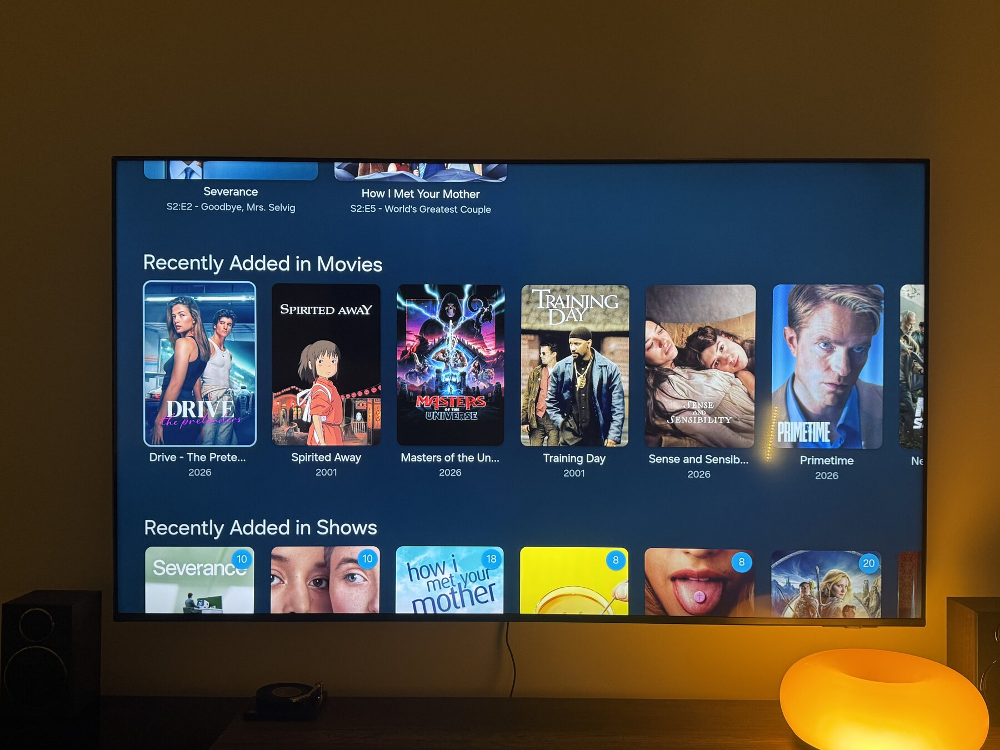

# Jellyfin-navy-blue-theme-TV-supported-

## Install

1. Back up your existing Custom CSS.
2. In **Dashboard → Branding → Custom CSS**, paste this line at the very top, above any existing rules.

   ```css
   @import url("https://cdn.jsdelivr.net/gh/GeorgiosIoannou02/Jellyfin-navy-blue-theme-TV-supported-@main/theme.css");
   ```

3. Save, then refresh Jellyfin Web or reopen the TV app. Each client needs access to jsDelivr to load the stylesheet.

[Jellyfin Custom CSS documentation](https://jellyfin.org/docs/general/clients/css-customization/)

## Gallery


*Jellyfin Web · Recently added movies and shows.*


*Jellyfin Web · Show details without a backdrop.*



*TV · A focused movie card on Home.*


*TV · Show details with playback controls in focus.*

## Appearance

The browsing interface uses dark navy (`#061A24`) behind library shelves, navigation, and title details. Cards and posters have 16px rounded corners. In TV layout, the selected card has a 4px blue-grey (`#83A9BB`) border with 20px rounded corners. Library progress bars have 8px rounded corners.

## Compatibility

Custom CSS applies to clients that use Jellyfin Web. The gallery shows the Web and TV browsing layouts. The focus rules target Samsung TV use. The TV model and client version are unconfirmed, and remote navigation and video playback still need device testing.

## Uninstall

Remove the import line from **Dashboard → Branding → Custom CSS**, save, then refresh Jellyfin Web or reopen the TV app.

## License

[MIT License](LICENSE) · Copyright © 2026 GeorgiosIoannou02
