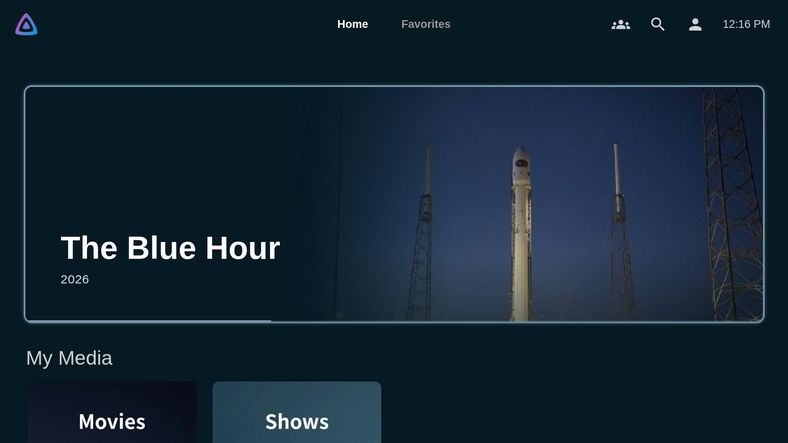

# Jellyfin Navy Blue

A dark navy theme for Jellyfin Web and the Samsung TV client, with an optional cinematic Continue Watching shelf.



*Jellyfin Web 10.11.11 in Chromium with TV layout enabled, using local sample media. Launch photograph by SpaceX and deep-field photograph by NASA, via [scikit-image](https://github.com/scikit-image/scikit-image/tree/v0.24.0/skimage/data).*

## Install

1. Back up your existing Custom CSS.
2. In **Dashboard → Branding → Custom CSS**, paste this line at the very top, above any existing rules.

   ```css
   @import url("https://cdn.jsdelivr.net/gh/GeorgiosIoannou02/Jellyfin-navy-blue-theme-TV-supported-@main/theme.css");
   ```

3. Save, then refresh Jellyfin Web or reopen the TV app. Each client needs access to jsDelivr to load the stylesheet.

[Jellyfin Custom CSS documentation](https://jellyfin.org/docs/general/clients/css-customization/)

## Enable the featured banner

1. Add the following import **immediately after the theme import**, above any CSS rules. For a pull request preview, replace `@main` in **both** URLs with `@` followed by the full commit SHA from the pull request. If the TV cannot reach the CDN, paste the contents of `theme.css` followed by `featured-banner.css` into Custom CSS.

   ```css
   @import url("https://cdn.jsdelivr.net/gh/GeorgiosIoannou02/Jellyfin-navy-blue-theme-TV-supported-@main/featured-banner.css");
   ```

2. In the viewing account’s **Settings → Home**, set **Home screen section 1** to **Continue Watching**. Move **My Media** or **My Media (small)** to another slot, replacing the old Continue Watching entry. TV layout can prepend a library shelf when both My Media variants are absent.
3. Save and reopen Home with a partially watched video. The first slot now shows wide, individually selectable panels. Use Left and Right to browse or Down to reach the next shelf.

The module uses the thumbnail or backdrop Jellyfin already chose, along with its title, secondary line and progress bar. For an episode, the two lines can be the series and episode names. The card builder requests a thumbnail-sized image based on the number of cards Jellyfin would normally display. The loader transfers that single URL from `data-src` to the card’s background. In the 1080p TV test, the loaded image measured 447 × 299 pixels. The card exposed no second, higher-resolution source. In landscape, the artwork fills the right 66% of the banner. It scales proportionally and crops at the edges to fill the frame. An opaque navy stop extends past the artwork’s left edge before fading into the image. A lighter bottom gradient keeps the progress line visible. Image quality depends on the asset Jellyfin delivers. [Card image selection](https://github.com/jellyfin/jellyfin-web/blob/v10.11.11/src/components/cardbuilder/cardBuilder.js) · [Image loader](https://github.com/jellyfin/jellyfin-web/blob/v10.11.11/src/components/images/imageLoader.js)

Landscape panels use approximately 94% of the available shelf width and 53% of viewport height. Portrait layouts keep Jellyfin’s 16:9 frame. The lower-left caption sits above the 3 px progress line. Desktop users can page with the two native arrows above the artwork. TV users can move directly between panels with the directional pad.

### How banner paging works

Jellyfin calculates the next card index by rounding down `(scroll position + frame width) / outer card width`. With the earlier `100vw` slot, a 1,329 px frame inside a 1,601 px viewport produced index zero on the first Next click. Changing the inner `.cardBox` width or its margins did not change that calculation. Jellyfin also subtracts scroller padding when deciding whether an end button should be disabled. [Arrow destination calculation](https://github.com/jellyfin/jellyfin-web/blob/v10.11.11/src/elements/emby-scrollbuttons/utils.ts) · [Button state and padding](https://github.com/jellyfin/jellyfin-web/blob/v10.11.11/src/elements/emby-scrollbuttons/emby-scrollbuttons.js)

Each outer card now fills one slider width. Where supported, the banner moves the safe-area gutters inside that slot and rounds the slider width to a CSS pixel to match Jellyfin’s integer measurements. This keeps Previous aligned when returning from the last card. Engines without CSS `:has()` retain Jellyfin’s frame padding, visible heading and native arrow styling. Engines without CSS `round()` use the percentage width.

## Gallery


*Jellyfin Web · Recently added movies and shows.*


*Jellyfin Web · Show details without a backdrop.*


*TV · A focused movie card on Home.*


*TV · Show details with playback controls in focus.*

## Appearance

The browsing interface uses dark navy (`#061A24`) behind library shelves, navigation, and title details. Cards and posters have 16px rounded corners. In TV layout, the selected card has a 4px blue-grey (`#83A9BB`) border with 20px rounded corners. Library progress bars have 8px rounded corners.

## Compatibility

The official Tizen app bundles Jellyfin Web. Its bundled Web version determines the markup available on the TV. The module targets the stable Home tab’s first section, its direct heading, the video resume scroller’s monitor attribute and its landscape cards. Next Up has a different heading structure. An empty resume list, a different first section, or a client missing these selectors falls back to its ordinary Home layout. [Tizen client build](https://github.com/jellyfin/jellyfin-tizen/blob/31408c121e34e73c9f50c4e201c05e95140675df/README.md) · [Web 10.10.7 resume shelf](https://github.com/jellyfin/jellyfin-web/blob/v10.10.7/src/components/homesections/sections/resume.ts) · [Web 10.11.11 resume shelf](https://github.com/jellyfin/jellyfin-web/blob/v10.11.11/src/components/homesections/sections/resume.ts) · [Card markup](https://github.com/jellyfin/jellyfin-web/blob/v10.11.11/src/components/cardbuilder/cardBuilder.js)

The base stylesheet now applies navy to the shared background only while Jellyfin has it in its opaque state. The player controls its own transparency. All banner styling lives in `featured-banner.css`. [Jellyfin playback transparency](https://github.com/jellyfin/jellyfin-web/blob/v10.11.11/src/components/backdrop/backdrop.js)

### Regression checks

| Check | Result |
| --- | --- |
| TV layout in Chromium, Web 10.10.7 and 10.11.11 | At 1920 × 1080 the banner interior measured 572 px high. Arrow keys moved across panels, down to My Media and back up. Enter opened details and Escape returned to Home. The focused ring measured 4 px with a 20 px radius. |
| Desktop arrows, Web 10.11.11 | Clicked Next and Previous through five distinct titles twice in both 1080p and 4K layouts. Each click showed exactly one expected title and changed the native scroll position. Previous was disabled at the first title and Next at the last. [Desktop arrows screenshot](screenshots/featured-banner-arrows.jpg) |
| Narrow Home pane, Web 10.10.7 and 10.11.11 | In a 1,329 px frame, Next showed The Blue Hour (start, 0 px), Northern Passage (1,329), Whiteout (2,658), After Sunrise (3,987) and Above the Timberline (5,316). Previous retraced all four positions to zero. Both round trips matched. |
| TV layout, Web 10.11.11 | Repeated the five-title round trips with directional keys at 1920 × 1080 and 3840 × 2160. A separate 1080p run exercised the percentage-width and native-padding fallback. [4K TV screenshot](screenshots/featured-banner-4k.jpg) |
| Desktop and mobile, Web 10.11.11 | At 1440 × 900 the banner measured 477 px high. At 390 × 844 it measured 367 × 206 px. Both showed the native title, progress and play action. |
| Other Home shelves, Web 10.11.11 | My Media, Next Up and both Recently Added shelves retained the same measured card dimensions and corner radii with the module enabled and disabled. Putting My Media or Next Up first produced zero banner matches. An empty Continue Watching list reserved no banner space. |
| Browsing, Web 10.11.11 | Opened the navigation drawer, movie and series detail pages, Home settings and the admin dashboard. |
| Browser playback, Web 10.11.11 | A local video resumed with the shared background transparent. With test Intro and Outro metadata supplied to the browser, both native skip prompts appeared and sought to the expected timestamps. |

Physical Samsung hardware, the Tizen video plane and model-specific remote behaviour still need an on-device check. The browser tests used a Chromium engine with a TV user agent for TV layout. The gallery’s original TV photographs predate the banner.

### Test on a Samsung TV

1. Note the TV model/year, Tizen version, Jellyfin app and server versions. Install the two stylesheets, enable server-provided Custom CSS on the client and set the Home slots as described above.
2. Open Home with at least five distinct resumable titles. Check a bright thumbnail, a long title and an episode. Confirm the title and progress bar are readable and the entire rounded focus ring is visible.
3. Press Right to the last title and Left back to the first twice. Check each press advances one title. Move down to the next row and back up. Press OK on a panel, then Back. Check that navigation reaches each card and focus returns to Home.
4. Start or resume a video. Open and dismiss the playback controls, seek and pause. Verify the picture stays visible. On a title with Intro and Outro segments and prompts enabled, activate both skip buttons.
5. Visit movie and series details, Next Up, Recently Added, the navigation menu, settings and the admin dashboard. Move Continue Watching out of slot 1 and check the standard shelves return. Repeat with an account that has nothing to resume.

## Uninstall

Remove the featured-banner import to restore the standard Continue Watching shelf. To remove the whole theme, remove both imports (or the pasted CSS), save, then refresh Jellyfin Web or reopen the TV app. Home section order is a separate account preference and can be restored in Settings → Home.

## License

[MIT License](LICENSE) · Copyright © 2026 GeorgiosIoannou02
